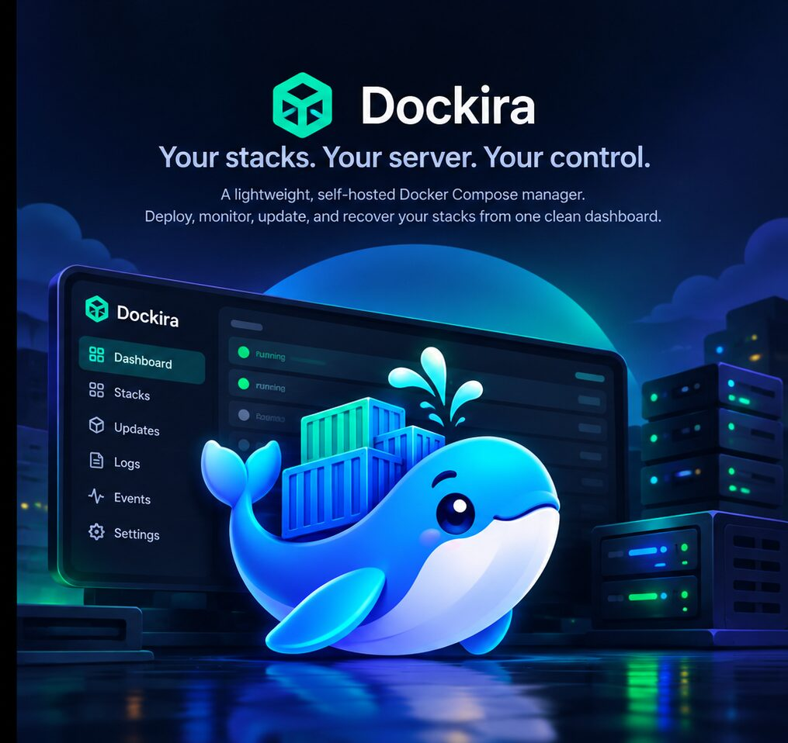
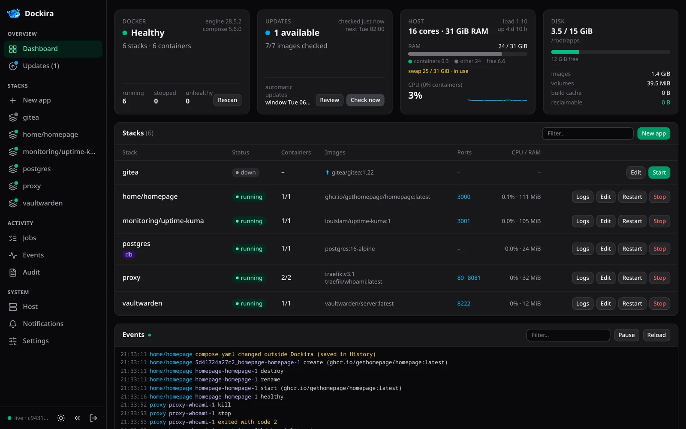
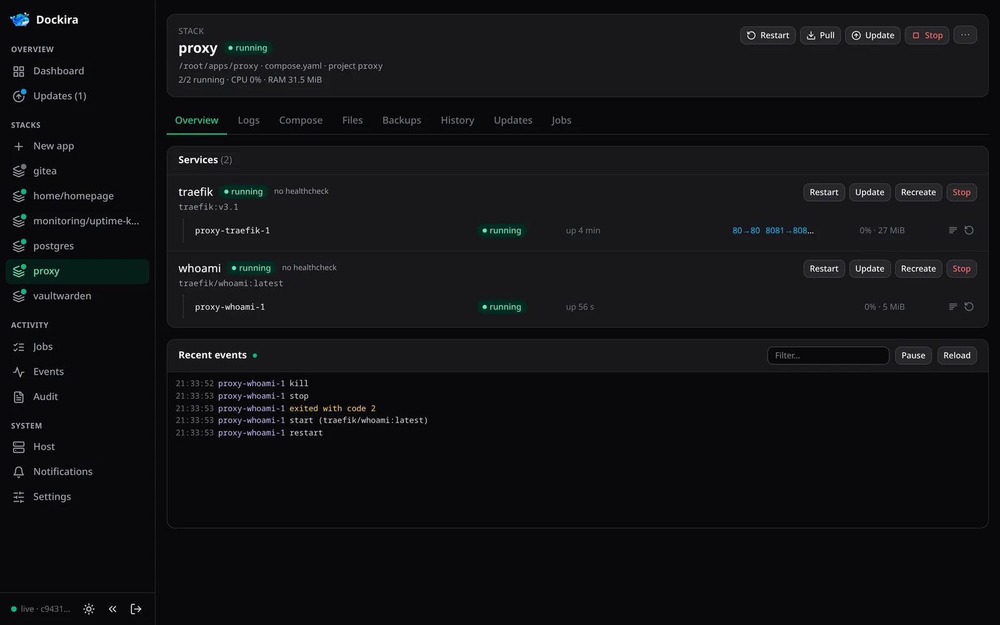
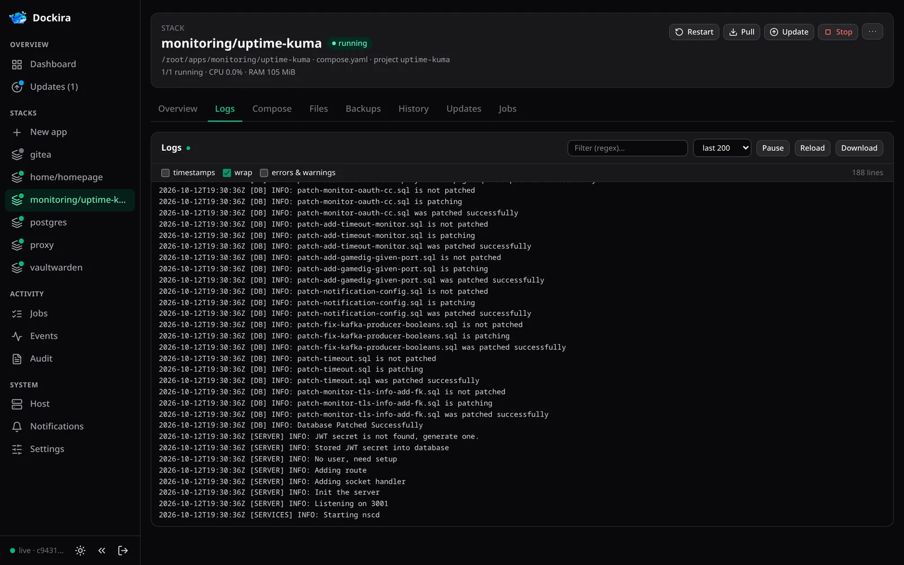
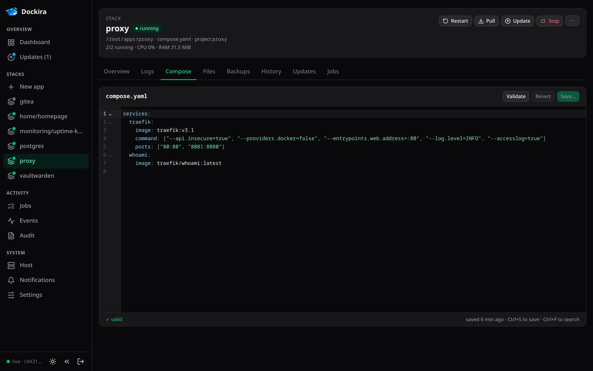
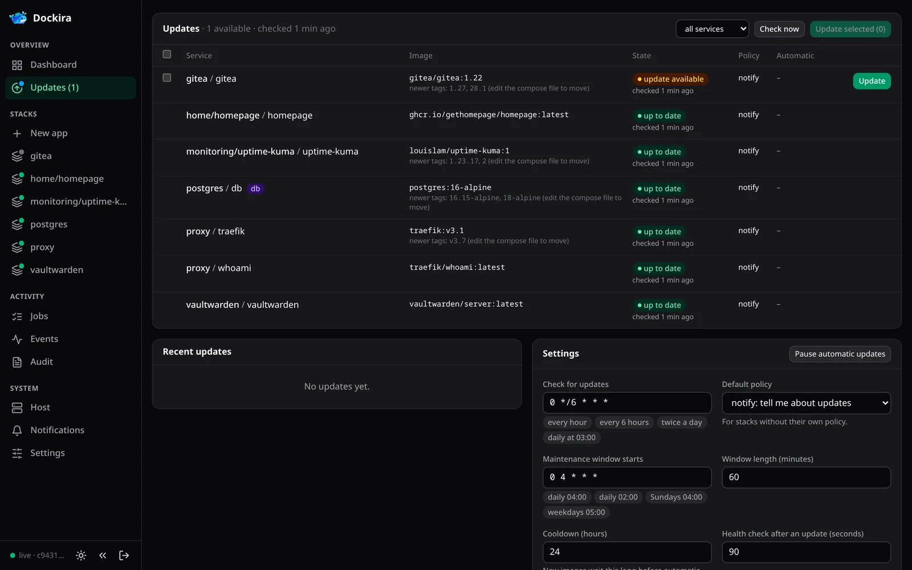
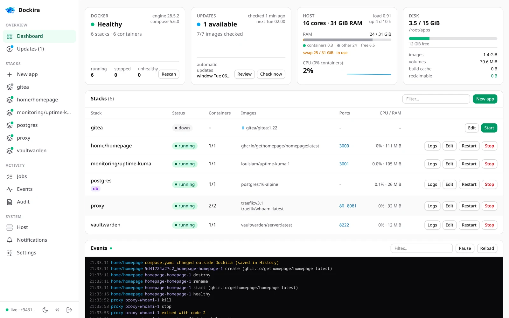
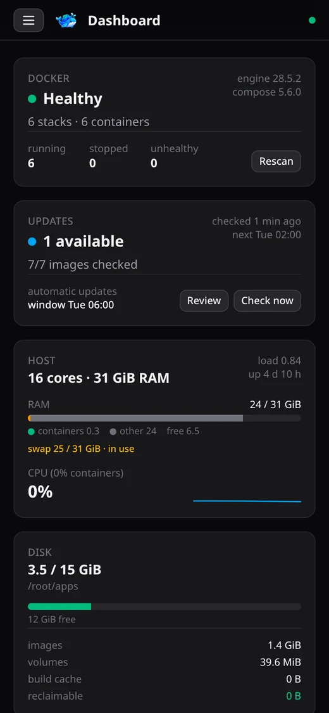

<p align="center">
  
</p>

<p align="center">
  <a href="https://github.com/pevecyan/Dockira/actions/workflows/ci.yml"></a>
  <a href="LICENSE"></a>
  
  
  
</p>

# Dockira

**A lightweight, self-hosted Docker Compose manager.** Deploy, monitor, update and recover your stacks from one clean dashboard.

You keep your apps the way you already do: one folder per app, each with a `compose.yaml`, all under one directory such as `/root/apps`. Dockira finds them on its own and gives you a fast web UI on top. There's nothing to import and no agent to install, and you're never locked in. Close the tab and your server is still just folders and compose files.



## Why Dockira

- 🗂️ **Your files stay the source of truth.** Dockira reads and writes the same compose files you edit over SSH. It notices changes made outside the UI and keeps every version.
- 🔄 **Updates that roll themselves back.** It checks images by digest, updates with one click (or automatically in a maintenance window) and puts the old image back if the new one doesn't come up healthy.
- 🔔 **It tells you when something breaks.** Crashes, restart loops, unhealthy containers, failed updates and low disk go to ntfy, Gotify, Telegram, Discord, Slack or any webhook.
- 🛡️ **Built for something that holds root.** Password login, brute-force limits, a password check before dangerous actions, a strict CSP and an audit log of every change.
- 🪶 **Small.** One Go binary with the UI built in, running as a single container. It uses about 20–40 MB of RAM and no external database.

## A closer look

<table>
  <tr>
    <td width="50%"><br><sub><b>Stacks</b>: services, containers, ports, live events and every action in one place.</sub></td>
    <td width="50%"><br><sub><b>Logs</b>: live, merged across a stack, with a regex filter and an errors-only view.</sub></td>
  </tr>
  <tr>
    <td><br><sub><b>Editor</b>: validated with <code>docker compose config</code> as you type, with a diff before saving.</sub></td>
    <td><br><sub><b>Updates</b>: digest checks, newer tag hints, per-stack policies and a maintenance window.</sub></td>
  </tr>
  <tr>
    <td><br><sub>Light and dark themes, following your system.</sub></td>
    <td align="center"><br><sub>Works on your phone too.</sub></td>
  </tr>
</table>

## Features

| Area | What you get |
|---|---|
| **Dashboard** | Docker, update, host and disk cards. A table of every stack with status, containers, images, ports and CPU/RAM. Containers not started by compose. A live event feed. |
| **Stacks** | Found automatically: any folder up to 3 levels under `apps_root` that has a compose file (`.dmignore` excludes folders). Containers are matched to their stack by compose labels. Leftovers show as *orphaned*, and projects outside `apps_root` as *external*. |
| **Actions** | Up, start, stop, restart, recreate, pull, update, rebuild, take down (and take down + delete volumes, which asks you to type the stack name and confirm your password). Actions apply to a whole stack or to single services. Each one runs as a job with live output, one per stack at a time, and can be cancelled. |
| **Logs** | Live logs merged across a stack (a colour per service) or from one container. Tail size, regex filter with highlighting, errors-only view, timestamps, pause, download. Follows recreated and restarted containers. |
| **Editor** | CodeMirror for the compose file(s), validated with `docker compose config` as you type (errors point to the line). A diff before saving, *Save & apply*, and conflict detection when someone edited the file over SSH. |
| **Files** | The whole stack folder: browse, view and edit text files (with highlighting for YAML, JSON, Dockerfile, shell, nginx, TOML, INI, Python, JS, XML and SQL; YAML, JSON and `.env` are checked before saving), create files and folders, upload, download, and delete (the last version stays in History). Files other than the compose files ask for your password first. |
| **History** | Every version of every file: edits, restores, and changes made outside the UI. Compare any version with the current file or the one before, and restore. Versions of `.env` and other non-compose files are encrypted. |
| **New apps** | Create an app from the UI: pick a folder, paste or write the compose file (or generate one from an image, port and data folder, with a free port suggested), add a `.env`, and start it right away. An existing folder without a compose file can be adopted. |
| **Updates** | Checks by image digest (so moving tags like `:latest` work), including base images of `build:` services. Shows newer version tags as hints. One-click update: a rollback image is tagged, the new image pulled, the service recreated, then checked for health; if it doesn't come up healthy, the old image is put back automatically. |
| **Auto-update** | Per stack/service policy: *manual*, *notify* or *auto*. Automatic updates only run in a maintenance window, after a cooldown, on healthy stacks, with enough free disk. Databases are skipped unless you opt in. A release that failed once isn't retried. Optional steps before every update: a volume snapshot, a `pg_dump`, or any command in a container. |
| **Backups** | Volume snapshots per app: named volumes and, if you want, bind-mounted folders, optionally with the app stopped for consistent databases. Take one now or before every update. Restore saves the current data as a *before restore* snapshot first. The last 3 are kept by default. |
| **Notifications** | ntfy, Gotify, Telegram, and webhooks (JSON, Discord, Slack, custom template). Rules choose events, stacks and minimum severity, and support quiet hours and repeat suppression. |
| **Host** | CPU/memory charts for the last 30 min, containers by memory, and Docker disk usage. Cleanup with a preview (dangling images, unused images, build cache) that never touches volumes, rollback images, or images your compose files name. |
| **Shell** | A terminal in any running container (xterm.js). Off by default (`exec_enabled`), asks for your password, and every session is audited. |
| **Audit** | Every change, login and password confirmation, with the IP. |

## Quick start

You need a Linux server (amd64) with Docker Engine and the compose v5 plugin, and your apps in folders under one directory. The examples use `/root/apps`.

> The binary, image and container are called `docker-manager`. Dockira is the name of the project and the UI.

### Option 1: build on the server

```sh
git clone https://github.com/pevecyan/Dockira.git && cd Dockira
docker build -f deploy/Dockerfile -t docker-manager .

mkdir -p /root/apps/docker-manager && chmod 700 /root/apps/docker-manager
cp deploy/compose.yaml /root/apps/docker-manager/
install -m 600 deploy/config.example.yaml /root/apps/docker-manager/config.yaml

docker run --rm -it docker-manager password   # choose a password, prints its hash → password_hash
docker run --rm docker-manager gen-key        # prints a random key → secret_key
nano /root/apps/docker-manager/config.yaml    # paste both values

cd /root/apps/docker-manager && docker compose up -d
```

Open `http://<server>:8090` and sign in.

### Option 2: deploy from your machine over SSH

```sh
deploy/deploy.sh root@your-server        # or put host= and user= in .env (see .env.example)
```

The script:
1. builds the image locally
2. copies it over SSH (`docker save | docker load`, no registry needed)
3. on the first run, creates `/root/apps/docker-manager/` with `compose.yaml` and a `config.yaml` holding a new `secret_key` and the password from `DM_PASSWORD` (or a generated one, printed once)
4. starts the stack and waits until it's healthy

Running it again upgrades the image and keeps the config and data. `DM_UPDATE_COMPOSE=1` also replaces `compose.yaml`. Use `DM_SSH_KEY` to choose an SSH key and `DM_DIR` to install somewhere else.

### Behind a reverse proxy

Put TLS in front with your proxy (Caddy, Traefik, nginx, Zoraxy, …) and tell Dockira about it in `config.yaml`:

```yaml
public_url: https://dockira.example.com   # Origin check (CSRF), HSTS, links in notifications
trusted_proxies: [192.168.1.10]          # X-Forwarded-* headers are believed only from these
```

If logins fail with *cross-origin request refused*, one of these two settings is missing.

The proxy must:
- pass `X-Forwarded-For`, `X-Forwarded-Proto` and `Host` (or `X-Forwarded-Host`)
- **not buffer** responses (the UI streams events and logs over SSE). Dockira sends `X-Accel-Buffering: no`. For nginx, also use `proxy_read_timeout 1h`.
- allow WebSocket upgrades on `/api/exec/` (the container shell)

## Configuration

`/root/apps/docker-manager/config.yaml` (mode 600) is read at startup; restart the stack after changing it. Each key can also be set as an environment variable `DM_<KEY>`, which is meant for development.

| Key | Default | |
|---|---|---|
| `listen` | `:8080` | inside the container. The compose file publishes it as 8090. |
| `apps_root` | `/root/apps` | mounted at the same path in the container, because compose resolves relative paths on the client |
| `scan_depth` | `3` | how deep to look for stack folders |
| `data_dir` | `/data` | SQLite database, backups and snapshots |
| `password_hash` | – | `docker run --rm -it docker-manager password` (bcrypt) |
| `secret_key` | – | `docker run --rm docker-manager gen-key`. Signs sessions and encrypts channel secrets and file history. **Back it up with `data/`.** |
| `public_url` | – | your HTTPS address behind a reverse proxy |
| `trusted_proxies` | `[]` | IPs/CIDRs of your reverse proxy |
| `ip_allowlist` | `[]` | if set, only these addresses reach the UI |
| `read_only` | `false` | look but don't touch |
| `exec_enabled` | `false` | container shell in the UI |

Update schedules, the maintenance window, per-stack policies and notifications are set in the UI and stored in SQLite.

**Change the password:**
```sh
docker exec -it docker-manager docker-manager password      # prints the new hash
```
Put the hash in `config.yaml`, then run `docker compose restart` in `/root/apps/docker-manager`. Every browser is logged out.

## Security model

The Docker socket is equivalent to **root on the host**, so the UI is guarded accordingly:
- **Password login only**, with a bcrypt hash in the config. The session cookie is signed with `secret_key` over its expiry and the password hash, so changing either logs everyone out. The cookie is `HttpOnly` and `SameSite=Strict`, and `Secure` behind HTTPS.
- **Brute force:** 5 tries per address, then one per minute. 30 failures per hour from all addresses pause logins for 15 minutes and send a notification. Logins from a new IP send a notification.
- **Password confirmation (10 min)** is required to open `.env` and other non-compose files, take a stack down with its volumes, open a shell, store notification secrets, restore a backup and remove unused images.
- **Requests:** changes and WebSocket upgrades must come from the UI's own origin. Strict CSP (no external resources), `X-Frame-Options: DENY`, `nosniff`, `no-referrer`, HSTS on HTTPS.
- **Files:** everything stays inside the stack folder (symlinks resolved), and writes are atomic and keep mode and owner. Dockira's own `config.yaml` and `data/` are locked. Secrets are scrubbed from job output.
- **The container** runs as root (it needs the socket and `/root/apps`) but is not privileged. `/proc`, the cgroup tree and `~/.docker` are mounted read-only.
- **Dockira's own stack** can't be stopped or taken down from the UI. Restarting or recreating it runs through a short-lived helper container.

## Operations

- **Backup:** `/root/apps/docker-manager/data/` together with `config.yaml`.
- **Logs:** `docker logs docker-manager`.
- **Inside LXC (Proxmox):** `/proc/meminfo` there is virtualised per process, so host memory and CPU come from the LXC's cgroup (`/sys/fs/cgroup` is mounted at `/host/cgroup`).
- **Rollback images** are tagged `dm-rollback/<project>-<service>:<time>`. The last 2 per service are kept (configurable).

## Development

Requirements: Go 1.27, Node 22 and a local Docker.

```sh
make dev-config   # dev/config.yaml (password: docker-manager-dev)
make fixtures     # start the fixture stacks in dev/apps on your local Docker
make dev          # Go server on :8090 + Vite on :5173 (proxying /api)
make test         # go vet + go test, vue-tsc + vitest
make e2e          # Playwright against a fresh instance on :8091 (real Docker + fixtures)
make gen-api      # regenerate web/src/api/schema.d.ts after changing API types
```

The fixtures in `dev/apps` cover a healthy nginx with a healthcheck, a chatty worker with a `.env`, a nested `build:` stack, a database-like redis, a never-started stack, a broken compose file, and `regtest`, which uses a local registry on `localhost:5055` for testing updates and rollbacks.

<details>
<summary>Project layout</summary>

```
cmd/docker-manager   serve, password, gen-key, openapi
internal/api         HTTP API (Huma → OpenAPI → TS types), SSE events/logs/jobs, exec WebSocket
internal/auth        login, sessions, throttling, CSRF, trusted proxies
internal/stacks      discovery: folders + compose config + container labels
internal/compose     the docker compose CLI
internal/docker      Engine SDK wrapper (containers, logs, events, exec)
internal/jobs        background jobs with live output
internal/files       file editing, validation, revisions
internal/updates     digest checks, update/rollback flow, policies, scheduler
internal/registry    registry client (go-containerregistry), tag hints, Dockerfile FROM parsing
internal/snapshots   volume and bind-folder snapshots
internal/alerts      notification channels/rules + host event detection
internal/notify      ntfy / Gotify / Telegram / webhook senders, rules, dispatcher
internal/hoststats   /proc + cgroup v2 stats (works inside LXC)
internal/store       SQLite + migrations
web/                 Vite + Vue 3 + Tailwind v4
deploy/              Dockerfile, server compose file, example config, deploy script
```
</details>

## Contributing

Issues and pull requests are welcome. Please run `make test` before sending a change, and `make gen-api` if you touched API types.

## License

[MIT](LICENSE) © Žan Pevec
